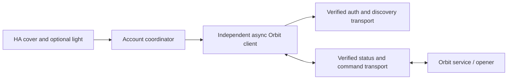

# Skylink Orbit API investigation

Research date: 2026-10-27 (America/Toronto).

## Outcome and evidence boundary

**Update: APK acquisition and static protocol recovery succeeded.** Orbit Home 3.8.9 (79) and 3.5 (55) were downloaded and decompiled. The real implementation uses signed HTTPS login and account-scoped MQTT for discovery, status and controls. See [recovered MQTT/API contract](orbit-mqtt-protocol.md), [authentication details](orbit-auth-discovery.md), and [APK provenance](apk-provenance.json). TLS service checks passed with hostname verification; account authentication and physical operation are still untested.

The supplied repository remains an unverified scaffold. The comparison below contrasts its assumptions with the recovered implementation. The workflow records what is complete and what still needs live validation.
The [Google Play listing](https://play.google.com/store/apps/details?id=com.mtqqdemo.skylink&hl=en_CA) identifies `com.mtqqdemo.skylink` as Skylink's Orbit Home app and describes remote garage monitoring/control, lights, sharing, and multiple doors. It does not document a network API. A package name resembling “MQTT demo” is a clue, not proof of transport.

Inspected [xerktech/ha-orbit](https://github.com/xerktech/ha-orbit) at commit `df537b011f4673b082d1f9de87e109d270e4f23b`. Local reference checkout: `upstream/ha-orbit/`, excluded from this repository's tracking. Its [SPEC §2](https://github.com/xerktech/ha-orbit/blob/df537b011f4673b082d1f9de87e109d270e4f23b/SPEC.md) explicitly says the protocol is a best guess and has not been confirmed against hardware. [Issue #2](https://github.com/xerktech/ha-orbit/issues/2) reports inability to reach the service; this corroborates the practical problem but does not identify the real service.

## API inventory: assumptions that must be replaced

These values come from upstream source, **not the Android app**. Do not send real credentials to them based on this document.

| Area | Upstream assumption | Recovered Android behavior |
| --- | --- | --- |
| API host | `https://api.orbit.skylinkhome.com` | `https://iot.skyhm.net:8444/skylinkhub_crm/` |
| Login | `POST /v1/auth/login`, JSON email/password | Signed JSON POST to `skyhm_api_s.jsp?cmd=act_login`; email/password |
| Session | Bearer access token, refresh token, expiry | Login returns `acc_no`; MQTT uses account password; no demonstrated refresh token |
| Discovery/status | `GET /v1/devices` includes status | MQTT `/get` request and `/get/result` snapshot |
| Door command | `POST /v1/devices/{id}/command` with string verb | MQTT `/desire`, numeric `ctrlgdo.cmd`; main door action is 0 |
| Push | MQTT over TLS, port 8883 | TLS MQTT at `34.214.223.70:1899`; subscribe QoS 1, publish QoS 0 |
| Topic | `orbit/{user_id}/{device_id}/status` | `skylink/things/client/{acc_no}/update/result` |
| MQTT auth | Login credentials returned in JSON or user ID/access token fallback | Username `acc_no`, password original account password |
| Status encoding | Generic strings plus numeric 0=closed / 1=open | 0=opening, 1=open, 3=closing, 4=closed; see full mapping |
| Extra entities | Light, obstruction, RSSI, battery | Light commands 3/4, reported light/RSSI fields; sensor semantics still incomplete |
| LAN control | Upstream calls devices cloud-only | Not established by evidence examined here |

Source: [upstream protocol constants](https://github.com/xerktech/ha-orbit/blob/df537b011f4673b082d1f9de87e109d270e4f23b/custom_components/orbit_gdo/orbitclient/const.py), [client](https://github.com/xerktech/ha-orbit/blob/df537b011f4673b082d1f9de87e109d270e4f23b/custom_components/orbit_gdo/orbitclient/client.py), and [models](https://github.com/xerktech/ha-orbit/blob/df537b011f4673b082d1f9de87e109d270e4f23b/custom_components/orbit_gdo/orbitclient/models.py).

## Whether to build on the existing project

Reuse its general separation between protocol client, coordinator, config flow, and entities, and preserve its MIT license/attribution if copying code. Treat its transport/auth/models as disposable until evidence exists. The claim that only constants and a couple of parsers need changing is premature: MQTT-only commands, binary payloads, different authentication, or per-device credentials would require larger changes.

Concrete issues seen in source that should be corrected if reusing it:

1. `cover.py` always advertises OPEN, CLOSE, and STOP, although command semantics are unverified. Expose only confirmed features.
2. `OrbitDevice.from_dict` defaults missing `online` to true; `merged_with` copies it unconditionally. A partial light update can therefore turn an offline device online. Separate full snapshots from presence-aware patches; missing and explicit unknown must remain distinguishable.
3. `coordinator.py` sets `_realtime_started` before attempting connection. The client swallows an initial connection failure, so subsequent polls do not retry startup. Give connection supervision an explicit lifecycle and backoff.
4. `diagnostics.py` redacts email/password in entry data but returns all device dataclasses, including arbitrary `extra` fields. Use a diagnostic allowlist; actual payloads may contain identifiers or credentials.
5. The reauth flow accepts the newly authenticated account without checking that its ID matches the original entry. Verify identity before updating the entry.
6. Model parsers accept many speculative formats. Replace guessing with tested parsers for observed schemas; unknown values must not imply a safe/closed/online state.

These are static source findings, not hardware test results. The existing test suite was not run for this design investigation; even passing fixture tests would not validate its assumed API.

## Reverse-engineering workflow

### 1. Obtain and identify the installed app

Preferred input: extract the Play-installed Android app, including all split APKs. This provides the relevant version and a stronger provenance baseline than an old mirror. Copying the installed APK is separate from accessing private application data; no account password is needed for static analysis.

Android's official [ADB documentation](https://developer.android.com/tools/adb) documents device authorization, `pm path`, and `adb pull`. With Platform Tools installed and a user-authorized device attached:

```sh
adb devices -l
adb -s PHONE_SERIAL shell pm path com.mtqqdemo.skylink
adb -s PHONE_SERIAL pull /exact/path/from/pm/base.apk artifacts/apk/base.apk
# Repeat pull for every split path reported by pm path.
shasum -a 256 artifacts/apk/*.apk
```

Use exact returned paths, remove only the `package:` prefix, and select a specific device if several are attached. Do not install a mirrored APK over the user's app. Store binaries and decompiled output locally under ignored `artifacts/`.

Initial Uptodown and APKPure browser attempts failed. A subsequent APKPure direct download using `d.apkpure.net` succeeded for 3.5 and 3.8.9. Both APKs were decompiled without execution. Hashes and signing-certificate fingerprints are recorded in [apk-provenance.json](apk-provenance.json); the new protocol notes contain actual static findings.

### 2. Static analysis first

Use [JADX](https://github.com/skylot/jadx) to decompile DEX and inspect resources/manifest, without executing the application. Record APK SHA-256, package/version, signer fingerprint, and tool version so every finding is reproducible.

Trace these code paths rather than treating isolated strings as proof:

- Login button → request construction → response parsing → stored auth state.
- Device screen → enumeration/ownership → per-device metadata and credentials.
- Door/light controls → command encoder → actual publish/request call.
- MQTT/socket callback → decoder → displayed status and movement states.
- Reconnect, logout, token expiry, device-offline and permission failure handlers.

Search candidate strings such as `https://`, `ssl://`, `tcp://`, `wss://`, `MqttClient`, `subscribe`, `publish`, `login`, `token`, `door`, `garage`, and `skylink`. Inspect native libraries or bundled JavaScript if Java/Kotlin code delegates there. Determine whether a host is production, test, provisioning, analytics, or push-notification infrastructure before using it.

Each recovered API operation needs: source class/method, endpoint/topic, exact request encoding and headers, response schema, auth derivation, error handling, and whether the finding is only static or also observed live. Keep embedded credential values out of reports.

### 3. Validate read-only with the owner's account

After identifying the actual auth flow, build a local probe that prompts for credentials with hidden input and logs only redacted summaries. Start with login, account identity, device enumeration, status and subscription to known owned devices. No cloud account is needed during APK decompilation; credentials should not be pasted into chat.

Verify simultaneous app/HA sessions, client-ID collisions, session expiry, reconnect, initial-state delivery, and whether a device list reports live or cached state. Do not assume TLS inspection is required: app code may reveal the protocol fully. If capture is needed, scope it to the user's test device; a normal HTTP proxy may miss native MQTT/TCP traffic. Modern Android trust behavior and potential certificate pinning need a separate test setup; see [mitmproxy's Android guidance](https://docs.mitmproxy.org/stable/howto-install-system-trusted-ca-android/).

### 4. Validate commands in an attended test session

Only after read-only validation, record one user-directed operation at a time with the door in view. Establish explicit open/close versus pulse, STOP support, acknowledgement versus final state, obstacle/fault behavior, and light state versus toggle. Never replay captured motion commands merely to test an encoder. Reconnect and retries must not replay motion after an ambiguous result.

## Integration architecture and milestones

See [Home Assistant design](home-assistant-design.md) for the sourced lifecycle and packaging details.



The recovered split is signed HTTPS login plus MQTT discovery, state and commands. The client should offer transport-independent operations: authenticate, list devices, get/subscribe state, issue a verified action, and close. Distinguish command acknowledgement, device transition, completion, rejection, and unknown outcome. Model missing fields explicitly. Serialize commands per device and never retain motion commands for reconnection.

| Milestone | Deliverable | Exit condition |
| --- | --- | --- |
| 1. Recover protocol — static work complete | Versioned API notes with source references | Auth, discovery, status and command encoding traced; live acceptance still pending |
| 2. Read-only client | Async library and sanitized fixtures | Lists the owner's opener and matches observed state |
| 3. Safe control | Command encoder and state machine | Attended validation of supported actions, timeout and reconnect behavior |
| 4. HA integration | Config flow, garage cover, reauth, diagnostics | Setup/reload/unload, outages and duplicate-command tests pass |
| 5. HACS release | README, compatibility matrix, manifest, CI | Installation and operation validated on stated HA/app/firmware versions |

Start with one garage cover; add a light only when its state and commands are verified. Obstruction, battery, RSSI, STOP, and percentage positioning are not initial promises. A user-installed MQTT broker should not be required if the app uses the vendor's broker directly.
